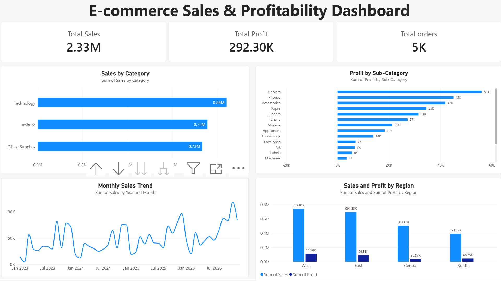

# E-commerce Sales & Profitability Analytics

## Project Overview
This project analyzes e-commerce sales and profitability using MySQL, Python, and Power BI. It explores sales performance, customer profitability, regional trends, discount levels, and shipping modes to identify business insights.

## Tools & Technologies
- **MySQL:** Data analysis using SQL queries, aggregations, CTEs, and window functions.
- **Python:** CSV data import into MySQL.
- **Power BI:** Interactive dashboard and data visualization.
- **Excel:** Dataset inspection and validation.

## Project Structure
```text
Ecommerce-Sales-Profitability-Analytics/
├── README.md
├── sql/
│   ├── 00_setup.sql
│   ├── 01_sales_profitability.sql
│   ├── 02_regional_analysis.sql
│   ├── 03_discount_analysis.sql
│   ├── 04_customer_analysis.sql
│   ├── 05_shipping_segment_analysis.sql
│   └── 06_advanced_window_functions.sql
├── python/
│   └── import_superstore.py
└── powerbi/
    ├── Ecommerce_Sales_Profitability.pbix
    └── screenshots/
        └── dashboard.png
```

## Business Questions
- Which product categories generate the highest sales and profit?
- Which sub-categories generate losses?
- How do sales and profitability vary by region?
- Which customers contribute the most profit?
- How are discount levels associated with profitability?
- How do shipping modes and customer segments perform?
- How do sales change over time?

## Key Findings
- Technology generated the highest category-level profit in the analyzed dataset.
- Copiers were the most profitable sub-category.
- Tables recorded a substantial loss.
- The West region recorded the highest total sales and profit among the regions analyzed.
- Some high-discount levels were associated with negative total profit.

## Power BI Dashboard

The dashboard presents e-commerce sales and profitability insights across product categories, regions, and discount levels.



## How to Use
1. Set up MySQL and create the project database.
2. Import the dataset using the Python script.
3. Run the SQL files in numerical order.
4. Open the Power BI file to explore the dashboard.

## Dataset
The project uses the Superstore dataset. Check the dataset's license and sharing permissions before distributing the original data.

## Disclaimer
Findings describe the analyzed dataset and do not necessarily establish causal relationships between business variables.
